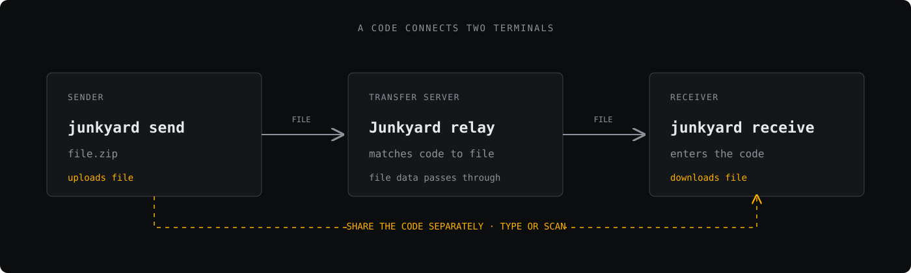

<h1 align="center">
  
</h1>

**Move files between terminals with a short code.**

Junkyard is a command-line file transfer tool for sending a file from one terminal and receiving it in another. The sender gets a six-character code; the receiver uses that code to retrieve the file. A QR code is available when scanning is easier than typing.

No account or browser upload form is part of the workflow. Junkyard consists of a CLI and a transfer server; it does not come with a hosted relay service.

## A transfer, at a glance

The code is shared separately from the file. The file travels through the Junkyard server to the receiving terminal.

  

## How it fits together

<table>
  <tr>
    <th align="left">Send</th>
    <th align="left">Share</th>
    <th align="left">Receive</th>
  </tr>
  <tr>
    <td>Choose one file or pass multiple files. Multiple files are packaged into a ZIP archive.</td>
    <td>Pass the generated six-character code to the recipient, or let them scan the QR code.</td>
    <td>Enter the code in the receiving terminal and choose where the file should be saved.</td>
  </tr>
</table>

The sender and receiver both use the Junkyard CLI. The transfer server relays file data between them. By default, the CLI connects to a server on `localhost:45845`; the server must be reachable by both sides. Junkyard does not operate a public file-transfer service.

## Product details

- **Short transfer codes:** generated using Go's cryptographic random source.
- **Terminal-first workflow:** send and receive files without switching to a web upload page.
- **QR-assisted handoff:** scan the sender's QR code instead of typing the code.
- **Multiple-file sends:** send several files together as a ZIP archive.
- **Authenticated file encryption:** the client encrypts file chunks before upload and verifies them after download.
- **Resumable downloads:** interrupted downloads continue from the saved byte offset.
- **Script-friendly output:** `--json` emits newline-delimited JSON events while transfers run.
- **Single Go CLI:** the product has no separate desktop or browser client.

## Commands

| Command | Purpose |
| --- | --- |
| `junkyard send <file...>` | Send one or more files and display a transfer code. |
| `junkyard receive [code]` | Receive a file using a code. |
| `junkyard server` | Run the transfer server. |
| `junkyard doctor` | Run environment diagnostics. |
| `junkyard version` | Print version information. |

## Security and scope

File data is encrypted in the client before it reaches the relay, and the receiver verifies the encrypted chunks before writing the file. The relay also receives the short code used to derive the encryption key, so this is not end-to-end protection from the relay operator. Use a relay you control for sensitive transfers. The repository does not include a hosted relay, user accounts, or a web companion.

## Project

Junkyard is proprietary software. Copyright Daddy Maou 2026. See [`LICENSE`](LICENSE).

Source repository: [github.com/daddymaou/junkyard](https://github.com/daddymaou/junkyard)
